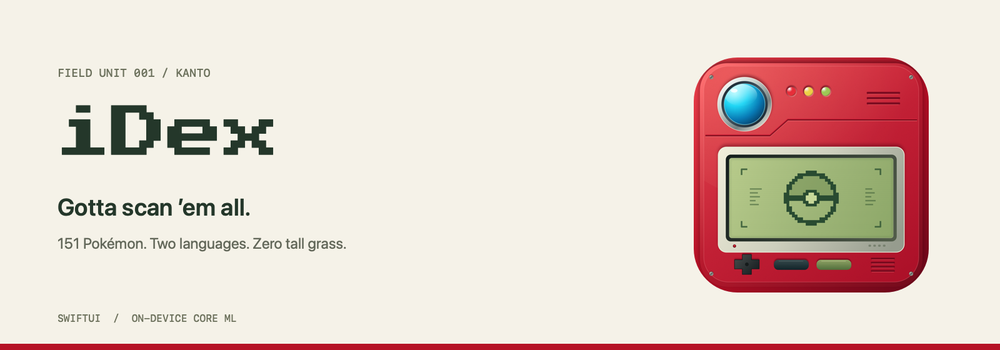
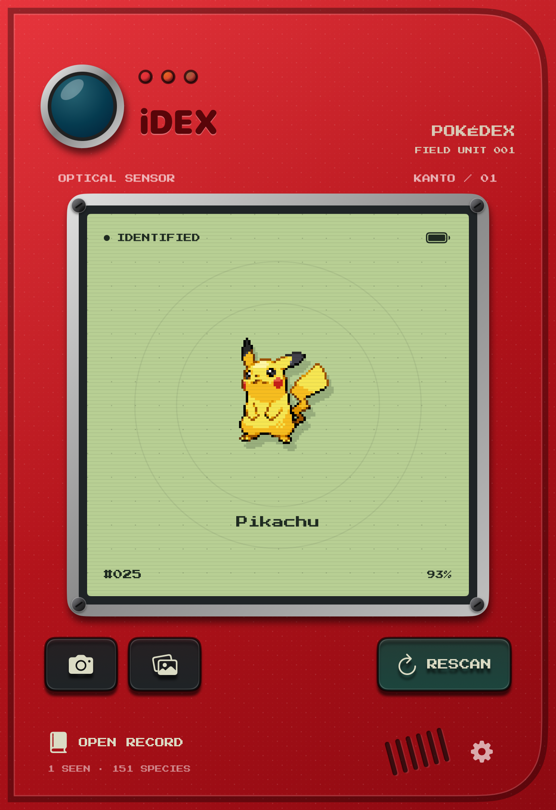
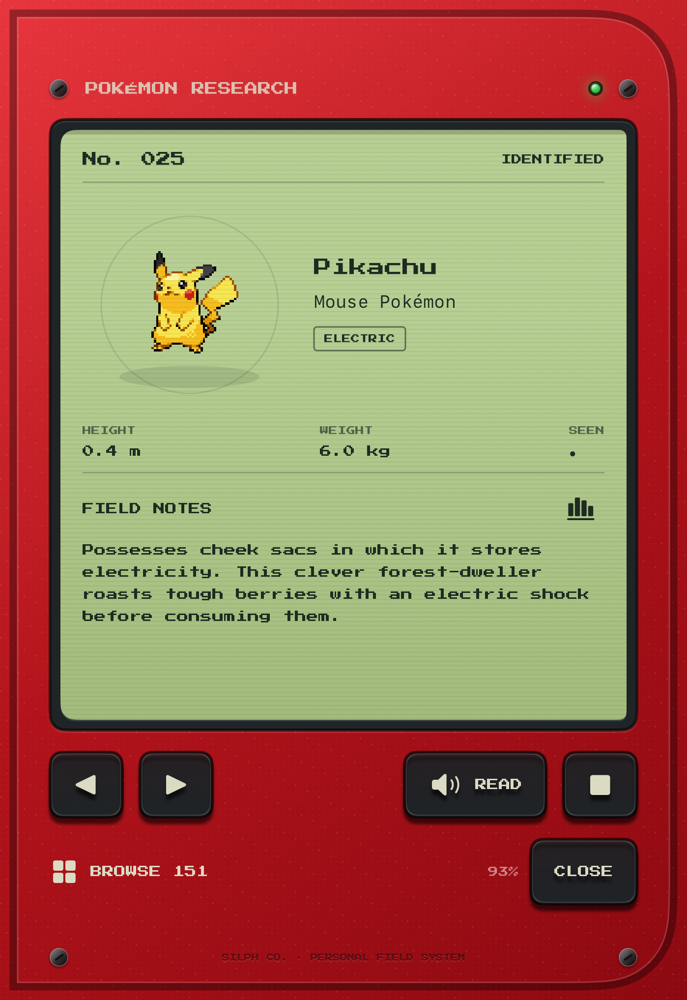
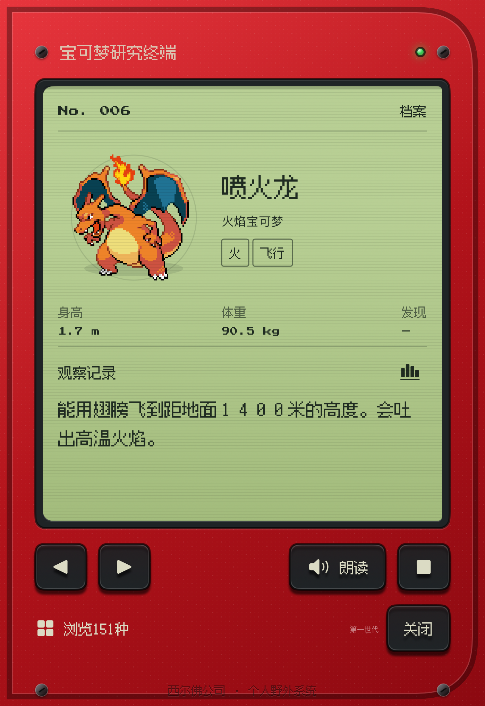

# iDex

A pocket Pokédex for iPhone Duo. Point, scan, and pretend Professor Oak gave you a research grant.

Native SwiftUI · English / 简体中文 · On-device Core ML

## A little field trip

| Scan it | Read about it | 中文也可以 |
| :---: | :---: | :---: |
|  |  |  |

No wild Pokémon were inconvenienced.

[Before the scan](docs/screenshots/scanner-sample-en.png) · [Search the archive](docs/screenshots/catalog-search-en.png)

## What's in the bag?

- **151 Kanto Pokémon.** Pixel sprites, stats, field notes, and cries.
- **Scan a photo or use the camera.** Recognition runs on your iPhone; photos stay in memory.
- **Unfold for more room.** The archive sits beside the scanner on the inner display.
- **English and 简体中文.** Search by name, number, or type; listen to spoken entries using installed system voices.
- **A local discovery log.** Your progress survives closing the app. Your research grant remains imaginary.

## Take it for a spin

You'll need **Xcode 27.1** and **iOS 27+**. Hinge observation uses iOS 27.1 APIs.

```sh
open iDex.xcodeproj
```

Select **iDex → iPhone Duo**, then Run. No packages, API keys, servers, or runtime downloads to configure. In Simulator, tap **Scan** to identify the sample Pikachu. On a device, allow camera access or import a photo.

Run the tests:

```sh
xcodebuild test -project iDex.xcodeproj -scheme iDex \
  -destination 'platform=iOS Simulator,name=iPhone Duo'
```

## Is it Professor Oak accurate?

Professor Oak has declined to comment. The model knows the original 151 species and can still mistake unrelated objects for Pokémon. Scores aren't calibrated probabilities; low-confidence guesses don't automatically become discoveries or trigger narration. Real camera accuracy and physical hinge behavior still need device testing.

## Under the hood

SwiftUI, AVFoundation, Core ML, and system speech. Everything runs locally.

[Development guide](docs/development.md) · [Model notes](iDex/Recognition/MODEL.md) · [Performance](docs/performance.md) · [Screenshots & graphics](docs/images/README.md)

## Thanks, humans

Sprites: [Pokémon Database](https://pokemondb.net/sprites). Data and cries: [PokéAPI](https://github.com/PokeAPI/pokeapi). Model: [BiernyVR](https://huggingface.co/BiernyVR/pokemon-classifier-mobilenetv3). Fonts: Press Start 2P and Fusion Pixel (SIL OFL 1.1).

[Full asset credits](iDex/Catalog/ATTRIBUTION.md) · [Model provenance](iDex/Recognition/MODEL.md)

An unofficial fan project. Pokémon belongs to Nintendo, Creatures, GAME FREAK, and The Pokémon Company. iDex is not affiliated with or endorsed by them.
